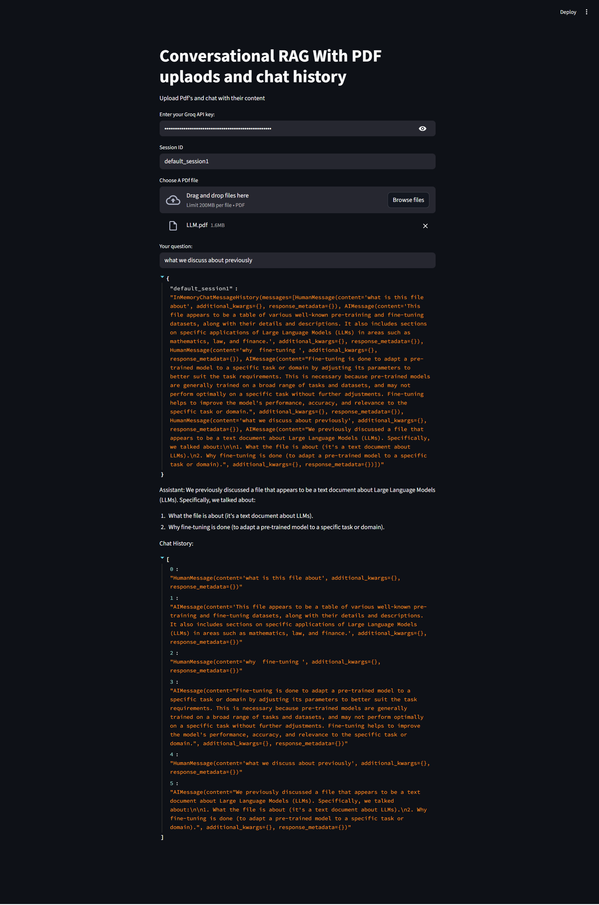

# Conversational RAG Q&A with PDFs (Chat History Enabled)

A **Conversational Retrieval-Augmented Generation (RAG) application** that allows users to upload one or more PDF documents and ask context-aware questions using **chat history**. The application leverages **LangChain**, **Groq LLMs**, **Hugging Face embeddings**, and **Chroma vector store** to deliver accurate, multi-turn question answering over document content.

---

## 🚀 Features

- 📄 Upload and query **multiple PDF documents**
- 💬 **Conversational Q&A** with persistent chat history
- 🧠 **History-aware retrieval** for context-following questions
- 🔍 Semantic search using **Hugging Face embeddings**
- ⚡ Fast inference using **Groq-hosted LLaMA 3.1**
- 🗂️ Vector storage with **Chroma**
- 🌐 Simple and interactive **Streamlit UI**

---

## 🧠 Architecture Overview

1. **PDF Ingestion**
   - PDFs are loaded using `PyPDFLoader`
   - Content is split into chunks using `RecursiveCharacterTextSplitter`

2. **Vectorization**
   - Text chunks are embedded
   - Stored in a Chroma vector database

3. **History-Aware Retrieval**
   - User questions are reformulated into standalone queries using chat history
   - Relevant document chunks are retrieved semantically

4. **Answer Generation**
   - Retrieved context is passed to Groq LLaMA 3.1 model
   - Responses are concise and grounded in document content

5. **Session-Based Chat Memory**
   - Each session maintains independent chat history
   - Enables multi-turn conversational flow

---

## 🛠️ Tech Stack

- **Python**
- **Streamlit** – Web interface
- **LangChain** – RAG orchestration
- **Groq API** – LLaMA 3.1 inference
- **Hugging Face Transformers** – Text embeddings
- **ChromaDB** – Vector store
- **dotenv** – Environment variable management

---

## 📸 Application Screenshots (Streamlit UI)

